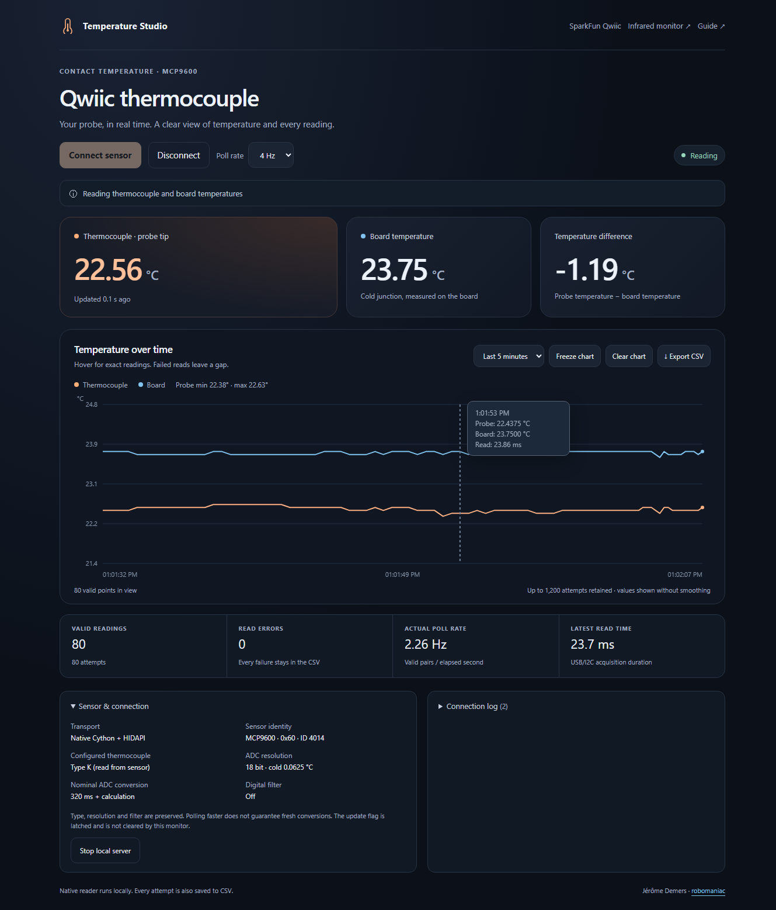

# Qwiic Thermocouple Monitor

**[Open the thermocouple monitor](https://robomaniac.github.io/mlx90614-mcp2221a/thermocouple.html)** — read a SparkFun MCP9600 board through the same MCP2221A USB bridge.

I added this separate monitor for contact temperature measurements. It shows the thermocouple tip, the board's cold junction, their temperature difference, and a live graph. It uses native Cython + HIDAPI locally or direct WebHID on GitHub Pages.



*Actual native-reader hardware session, Type K configured on MCP9600 revision 0x14. These readings are not a calibrated accuracy test.*

## Use the local native dashboard

Prerequisites: the existing MCP2221A and wired Qwiic board; x64 CPython 3.10+ for first setup. This shares the [native demo's environment](../mlx90614-hidapi-demo/README.md), dependencies and compiled extension. An existing installation is reused; no second Python installation, activation or firmware flash is needed.

1. Open this repository in **VS Code → File → Open Folder**, then **Terminal → New Terminal → PowerShell**. Work from the repository root. Close other sensor readers and disconnect browser WebHID tabs before starting acquisition.
2. Start the monitor and connect the sensor:

   ```powershell
   powershell -NoProfile -ExecutionPolicy Bypass -File .\08_Software\qwiic-thermocouple\Start-Monitor.ps1 -Connect
   ```

   The launcher checks/reuses the native environment, starts the loopback server, and opens your browser at **http://127.0.0.1:8766/**. First setup installs the native demo's pinned dependencies and builds its extension; later starts reuse it. Expect **Reading**, two Celsius values, increasing valid-reading counts and **Native Cython + HIDAPI** under *Sensor & connection*. Stop on setup/import errors. If the server is already running, open that URL and use its controls instead of starting another server.
3. Start at **2 Hz**. Hover over the graph for exact stored values. **Freeze chart** keeps acquisition and CSV recording running; **Clear chart** clears the displayed view and retains earlier CSV rows. Choose 1/2/4 Hz as needed; these change host polling, not sensor conversion settings.
4. Click **Export CSV** to download this session's attempted readings, including errors. Each connection also creates a unique CSV under `08_Software/qwiic-thermocouple/output/`. Native CSV files contain the whole session; plotted history retains the latest 1,200 attempts. These measurements stay local and are ignored by Git.
5. Click **Disconnect** to finish the current read and close HID. The last values stay visible but dim, with their age shown. Reconnect from this same dashboard; no rebuild or server restart is required. A new connection starts a new chart/counters/CSV.
6. For cleanup, click **Sensor & connection → Stop local server**, or press **Ctrl+C in the PowerShell window that launched it**. This stops acquisition, closes the bridge and stops the server. Retained CSVs remain available locally. Restart with the complete command in step 2 when needed.

If no browser opens, use the local URL above. If you see **Connection stopped**, open *Connection log*, retain its error and CSV, and check the bridge/probe/address and other readers before reconnecting. Read faults stop acquisition; the monitor does not hide them with retries, cancellation or USB reset.

### Optional address, port and bridge selection

The connected board was identified at `0x60`. If your board uses a different ADDR setting, for example `0x62` (decimal 98), stop the current server and run:

```powershell
powershell -NoProfile -ExecutionPolicy Bypass -File .\08_Software\qwiic-thermocouple\Start-Monitor.ps1 -Address 98 -Connect
```

Expected sensor identity should show `0x62`. Stop on identity/read failure; selecting an address does not reprogram the board. Supported addresses are `0x60`–`0x67`. With multiple bridges, enumerate using the existing demo's `-List` command and supply its index:

```powershell
powershell -NoProfile -ExecutionPolicy Bypass -File .\08_Software\mlx90614-hidapi-demo\Run-Demo.ps1 -List
powershell -NoProfile -ExecutionPolicy Bypass -File .\08_Software\qwiic-thermocouple\Start-Monitor.ps1 -DeviceIndex 0 -Connect
```

If port 8766 belongs to another application, use a different port:

```powershell
powershell -NoProfile -ExecutionPolicy Bypass -File .\08_Software\qwiic-thermocouple\Start-Monitor.ps1 -Port 8767 -Connect
```

Expect the browser at `http://127.0.0.1:8767/`. These commands run in PowerShell at the repository root. Stop and retain diagnostics on any setup/read error.

## Use it directly on GitHub Pages

1. Disconnect the local native reader and any other bridge clients. Open **[the standalone app](https://robomaniac.github.io/mlx90614-mcp2221a/thermocouple.html)** in desktop **Chrome or Edge**. Mobile browsers do not provide this USB path; the responsive layout also works for viewing the local native dashboard.
2. Keep **Address 0x60** for the default SparkFun board, or choose the actual ADDR setting. Click **Connect sensor** and select the MCP2221A if prompted. The app reuses previously granted HID permission where available.
3. Expect **Chrome / Edge WebHID** under *Sensor & connection* and valid readings. Use the same chart/rate/export controls. **Disconnect** waits for an in-flight read before closing HID. Stop on a connection fault and inspect the log.

`thermocouple.html` is one deployable HTML file with embedded CSS/JS, no libraries/CDNs/build and no required backend. GitHub Pages serves it separately from the original infrared monitor. Browser CSV export retains the latest 10,000 attempts; history/logs are bounded. A missing/mismatched HID reply stops the connection to avoid reusing stale responses. The direct browser driver has simulated protocol/UI checks; the physical hardware checks below exercised the native driver.

For optional local editing of the standalone WebHID version, disconnect native acquisition, open **another PowerShell terminal at the repository root**, then run:

```powershell
python -m http.server 8001 --bind 127.0.0.1 --directory .\08_Software\qwiic-thermocouple
```

Open `http://127.0.0.1:8001/thermocouple.html` in desktop Chrome/Edge. Expect the direct WebHID transport; the static server never opens USB. Reload after saving edits; no rebuild. Press Ctrl+C in this server terminal to stop it.

## Hardware and BOM

| Qty | Component | Manufacturer / part | Relevant specifications |
| --- | --- | --- | --- |
| 1 | Qwiic thermocouple amplifier | **SparkFun MCP9600**: [SEN-16295 screw-terminal board](https://www.sparkfun.com/products/16295) or [SEN-16294 PCC connector board](https://www.sparkfun.com/products/16294) | Default I2C address `0x60`; 3.3 V Qwiic interface; signed temperature output at **0.0625 °C/LSB**; supports K/J/T/N/S/E/B/R; four alert outputs |
| 1 | Thermocouple probe | Exact probe model and physical type unconfirmed; chip is configured for **Type K** | Match probe type to the chip's setting and connector polarity. Type-K chip measurement range is −200 to +1350 °C; the actual probe/cable may have narrower ratings. |
| 1 | USB-to-I2C bridge | **Microchip MCP2221A**; reference breakout [Adafruit #4471](https://www.adafruit.com/product/4471) | HID I2C path, project bus **100 kHz**, 3.3 V logic; physical bridge board model remains unconfirmed |

The actual sensor returned device ID **`0x4014`**, sensor configuration **`0x00`**, and device configuration **`0x00`**: MCP9600 revision 0x14, Type K, filter off, 18-bit ADC, 0.0625 °C cold-junction resolution, continuous conversion. I2C cannot identify which SparkFun connector variant or physical probe is fitted.

| MCP2221A board | Qwiic signal | Standard Qwiic wire |
| --- | --- | --- |
| 3V, with 3.3 V logic | 3.3 V | Red |
| GND | Ground | Black |
| SDA | SDA | Blue |
| SCL | SCL | Yellow |

Use the board's actual signal labels and existing compatible pull-ups. Connect the thermocouple to the amplifier's marked **+ / −** terminals or matching PCC connector. See the [SparkFun hookup guide](https://learn.sparkfun.com/tutorials/sparkfun-qwiic-thermocouple-hookup-guide), [board hardware](https://github.com/sparkfun/Qwiic_Thermocouple_Amplifer), and [Microchip datasheet](https://ww1.microchip.com/downloads/en/DeviceDoc/MCP960X-L0X-RL0X-Data-Sheet-20005426F.pdf).

## CSV timestamps and columns

| Column | Meaning |
| --- | --- |
| `sequence` | Attempt number within this connection, including failed attempts |
| `timestamp_ms` | Time the PC finished the read attempt, in Unix milliseconds since `1970-01-01T00:00:00Z` |
| `status` | `ok` for a valid pair, or `error` for a failed pair |
| `hot_c`, `cold_c` | Thermocouple tip and board cold-junction temperatures in Celsius |
| `hot_raw`, `cold_raw` | Sensor temperature words in hexadecimal, decoded as signed 16-bit values at 0.0625 °C/LSB |
| `sensor_status` | Status-register byte as a decimal integer |
| `acquisition_ms` | Duration of the status → probe → board → status USB/I2C read, in milliseconds; measured using the host's monotonic clock |
| `error_code`, `error` | Failure code and message; blank for successful pairs |

In the example `timestamp_ms = 1791662872046`, the time is **2026-10-10 20:07:52.046 UTC**, or **1:07:52.046 PM PDT**. `acquisition_ms = 23.7189` means the read took **23.7189 milliseconds**, approximately 0.02372 seconds. The timestamp dates the completed attempt; it is not the sensor's internal conversion time. Acquisition duration does not set the polling interval or sensor conversion rate. The dashboard displays local times; Unix timestamps identify the same instant in every timezone.

## Timing and limits

| Topic | Behavior / limit |
| --- | --- |
| Host polling | 1, 2 or 4 Hz; serial reads, no overlapping bridge commands |
| Current ADC conversion | 18-bit: nominal **320 ms**, plus calculation time. More polls do not establish more fresh conversions. |
| Other ADC settings | 16/14/12 bit give nominal 80/20/5 ms conversion with lower ADC resolution. This monitor reads existing settings and does not change them. |
| Freshness | Update status is latched and is not cleared by this read-only driver. Repeated words and status bit 6 do not establish unique conversion timestamps. |
| Temperature pair | Probe and board registers are read sequentially. Host timestamps are read-completion timestamps, not simultaneous sensor conversion timestamps. |
| Fault handling | Input-range bit checked before and after each pair. Reject the whole pair and stop on a fault; keep raw error evidence. A clear status does not independently verify a physically connected/correct probe. |
| Sensor communication | MCP9600 uses two-byte big-endian signed values; the MLX90614's word format and PEC do not apply. The pointer is set before each register read, as described by the [MCP9600 errata](https://ww1.microchip.com/downloads/aemDocuments/documents/OTH/ProductDocuments/Errata/MCP9600-Data-Sheet-Errata-80000741.pdf). |
| Accuracy | Resolution and displayed decimal places are not calibrated accuracy. No reference-temperature comparison has been performed. |

Microchip also describes self-heating from frequent I2C activity. The moderate polling choices suit this board; the MLX90614 unpaced stress mode is not applied to it.

## Validation and recovery

Actual hardware/UI results and the earlier MLX90614 rerun are in [the test record](../../05_Data/QWIIC_THERMOCOUPLE_TESTS.md). Native hardware worked at 100 kHz without USB reset or sensor configuration writes. The dashboard was exercised in Chrome with real native readings, chart hover/freeze/clear, CSV export and two reconnects. This does not establish calibrated accuracy, direct WebHID hardware behavior or long-run reliability.

For software checks, open **PowerShell at the repository root** after the native setup in step 2, then run:

```powershell
.\08_Software\mlx90614-hidapi-demo\.venv\Scripts\python.exe -W error::ResourceWarning -m unittest discover -s .\08_Software\qwiic-thermocouple -p test_sensor.py -v
powershell -NoProfile -ExecutionPolicy Bypass -File .\08_Software\qwiic-thermocouple\Check-UI.ps1
```

Expect **11 tests OK** and UI/protocol **PASS**; these checks do not open USB. Stop on any failure before testing hardware. GitHub runs these checks on clean Windows/Node environments.

To return to the existing infrared app, click **Disconnect** here, then open the [MLX90614 monitor](https://robomaniac.github.io/mlx90614-mcp2221a/). Its active HTML and archived baseline were not modified for this addition. Use its [existing recovery/baseline guide](../mlx90614-webhid/README.md) for browser troubleshooting. No MCP2221A USB reset is issued by either new driver.
