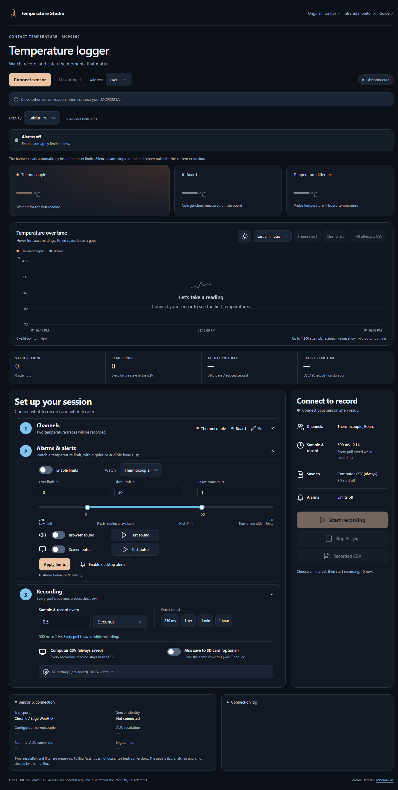

# Temperature Logger

**[Open the Temperature Logger](https://robomaniac.github.io/mlx90614-mcp2221a/logger.html)** — alarms, named traces, Celsius/Fahrenheit and CSV recording for the MCP9600 thermocouple in desktop Chrome/Edge. For native Cython + HIDAPI, use **http://127.0.0.1:8768/** after starting the reader below.

I kept the original dashboard and added this separate page for logging experiments. It reads through the MCP2221A using standalone WebHID or the existing Cython + HIDAPI environment locally. Optional Qwiic OpenLog support sends the recorded CSV to a new file on microSD. The GitHub Pages version uses WebHID directly; the native reader runs locally.



## Features

| Feature | What it does |
| --- | --- |
| Guided setup | Channels → Alarms & alerts → Recording, with a session summary and explicit SD close result. |
| Appearance | Sun/moon button beside the chart switches light/dark themes and remembers the choice locally. |
| Names and units | Name the probe and board traces; switch every temperature display, chart and alarm input between °C/°F. CSV includes both units. |
| Sample & record interval | One control from **250 ms through 24 hours** sets the poll period. **Every actual poll during recording is saved**; there is no separate save interval. 250 ms = 4 Hz, 500 ms = 2 Hz, 1 second = 1 Hz. Custom intervals use their exact reciprocal rate. Overdue polling slots are skipped rather than fabricated. |
| Limits | Low/high alarm on either channel, graph limit lines and alarm/reset markers, a reset margin, Silence alarm and Rearm alerts. |
| Optional alerts | **High: red, three short rising beeps. Low: blue, two longer falling tones.** Matching banner, viewport pulse, sensor outline and graph markers; separate sound previews and desktop notifications after permission. Reduced motion gives a steady border. |
| CSV | Download recorded rows or every polling attempt, including read faults and logger errors, UTC timestamps, raw words and acquisition duration. |
| Optional SD | New, exclusively created `Txxxxxxx.CSV` file in the card root; 31-byte text chunks, synchronization and exact stored-size checks. Existing files are preserved. |

**Hardware status: native SD recording passed.** OpenLog at **0x2A** now runs **local firmware 3.101**, which keeps SPI powered during sleep. A short **2 Hz polling / 1 second recording** trial produced **19 valid reads, zero read errors and 9 saved rows**; all **1,263 bytes** on the 32 GB card matched the downloaded PC CSV. Separate **61-byte** and **91-byte** CSV checks also passed, including one-second idle gaps. MCP9600 **0x4014** responded at **0x60**. An earlier sensor NACK is retained in the evidence; its cause is unresolved. A second native **4 Hz polling / 250 ms recording** trial saved **34 valid rows with zero errors** over **8.429 seconds**; median row interval was **250 ms** (235–254 ms). All **4,148 SD bytes** matched the PC CSV exactly. Standalone browser WebHID SD has simulated coverage only. See [firmware/reproduction/rollback instructions](../../00_Documentations/OPENLOG_FIRMWARE.md) and [actual results](../../05_Data/TEMPERATURE_LOGGER_TESTS.md#verified-3101-hardware-recording).

## Try the guided UI

1. In **Chrome/Edge**, open **http://127.0.0.1:8768/** and press **Ctrl+R**. The guided layout is **Channels → Alarms & alerts → Recording**, with actions and session results on the right. If the page displays a native-reader restart notice, follow **Load the native reader update** below; the existing compiled transport/environment and CSV files are reused. HTML-only edits need just a reload. For standalone WebHID, Stop & sync, export and Disconnect before reloading.
2. Click **Channels → Edit** to name the two traces. Click **Display** above the readings for Celsius/Fahrenheit. Custom menus support Arrow Up/Down, Home/End, typing and Enter; Escape/outside click closes them. Names and sample settings lock during recording.
3. In **Alarms & alerts**, drag either limit handle or enter exact limits and reset margin, then click **Apply limits**. The slider's current marker uses the selected channel and disappears when readings become stale. **Test sound** plays a tone; **Test pulse** shows a red border around the whole browser window for six seconds. Acknowledge silences an actual excursion. Click the **sun/moon button beside the chart** to switch themes.
4. Under **Recording**, choose **Sample & record every**, or a preset. **250 ms means 4 polls and 4 saved rows per second while recording**. **1 hour means one poll and one saved row per hour**, not 2 Hz polling with discarded intermediate readings. A first reading is taken immediately at recording start. Alarms and the live chart follow the same interval, so choose a short interval for timely alarms. Sensor conversion time, USB and SD latency can limit the actual rate.
5. Keep other readers disconnected, click **Connect sensor**, enable **Also save to SD card** if wanted, and click **Start recording** in the summary. PC CSV is always retained during recording; SD is an optional copy. Expect growing rows and SD filename/verified bytes. Stop on errors and keep the log/CSV.
6. Click **Stop & sync**. The summary's **Session result** must show green **SD file closed** after SD completion. A PC-only session says **Recording stopped · SD was off**. Download **Recorded CSV**, then **Disconnect**. Keep the card powered/inserted until completion, and remove power before moving it to a card reader.

## Why one interval controls both polling and recording

Poll rate and poll interval describe the same schedule: **rate in Hz = 1 / interval in seconds**. The former design allowed faster live polling and slower recorded rows, which is useful for reduced-size trend logs but loses intermediate readings from that recording. This version removes that separation: the recording CSV receives every actual polling attempt from Start recording to Stop & sync. **All attempts CSV** additionally includes polling outside the recording session. Errors are retained in the PC CSV; after a sensor/bus failure the app stops rather than trying more SD transactions on an unhealthy bus.

| Sample interval | Poll rate | Recorded rows while running |
| --- | --- | --- |
| 250 ms | 4 Hz | One row per poll, about 4 per second |
| 400 ms | 2.5 Hz | One row per poll, about 2.5 per second |
| 500 ms | 2 Hz | One row per poll, about 2 per second |
| 1 second | 1 Hz | One row per poll, about 1 per second |
| 1 hour | One poll per hour | Immediate first row, then one per hour |

Requested rates are scheduling targets. Overruns skip unperformed polling slots without making up readings; the existing attempt/error statistics remain visible. The native service retains full CSV files. Standalone WebHID keeps the latest **10,000 rows per browser buffer**; use SD or the native service for longer recordings.

## Use standalone WebHID locally

1. Disconnect every other browser/native sensor reader. Open **VS Code → Terminal → New Terminal → PowerShell**, at the repository root, and run:

   ```powershell
   python -m http.server 8001 --bind 127.0.0.1 --directory .\08_Software\temperature-logger
   ```

   Open **Chrome or Edge → http://127.0.0.1:8001/logger.html**. Reuse this URL if that static server already exists. Keep the default MCP9600 address **0x60** and **0.5 Seconds** sampling (**2 Hz**). Click **Connect sensor**, choosing the MCP2221A when prompted. Expect **Reading** and two temperatures; stop and inspect **Connection log** on an error.
2. Expand **Channels** and enter the **Probe name** and **Board name**. The cards, chart legend, hover and alarm-channel menu update immediately. Select **Celsius** or **Fahrenheit** above the temperature cards. The difference uses the correct temperature scale, without an absolute-temperature offset.
3. Set **Sample & record every** and **Interval unit**, or click a preset. For 250 ms enter **0.25 Seconds** or choose its preset. This also sets polling to **4 Hz**; there is no separate poll/save rate. Enable SD only for hardware that has passed write/readback validation. Click **Start recording**; every actual poll becomes a recorded row. Names and interval are locked during recording.
4. Click **Stop & sync**, then **Recorded CSV** to download that recording. **All attempts CSV** exports the polling session separately. Browser buffers keep the newest **10,000 rows each**, and the chart keeps 1,200 attempts. Export before reload/reconnect, which starts fresh buffers. Freeze/Clear affect the chart only.
5. Click **Disconnect** when finished. It waits for the current transaction and normal SD finalization before closing HID. Last values dim and show their age; alarm monitoring displays **paused**. Keep errors and exported CSV when troubleshooting. Press **Ctrl+C in the static-server PowerShell window** to stop hosting when finished.

There is one deployable HTML file: **`logger.html`**. CSS/JavaScript are embedded; no CDN, build, account or backend is required for WebHID. The [original thermocouple page](https://robomaniac.github.io/mlx90614-mcp2221a/thermocouple.html) and [infrared page](https://robomaniac.github.io/mlx90614-mcp2221a/) remain available.

## Use the existing native environment

Prerequisites: wired MCP2221A/MCP9600, desktop browser, and the existing native demo environment. First setup needs x64 CPython 3.10+; the launcher provisions the demo's dependencies/build if absent. Later runs reuse them. Sensor acquisition needs no firmware flash or environment activation. This setup's SD logger already has the tested local 3.101 firmware; reuse it without reflashing.

1. Open **VS Code → File → Open Folder → this repository**, then **Terminal → New Terminal → PowerShell**. The working directory must be the repository root. Disconnect competing readers. Start the new server without opening USB:

   ```powershell
   powershell -NoProfile -ExecutionPolicy Bypass -File .\08_Software\temperature-logger\Start-Logger.ps1
   ```

   Expect the browser at **http://127.0.0.1:8768/** and **Native Cython + HIDAPI** under *Sensor & connection*. Stop on setup/import errors. If this server is already running, reuse that URL; do not launch another instance. Reload the page after a server restart so its controls obtain the new local session token.
2. Click **Connect sensor**, then use the same numbered recording/alarm steps above. This server uses a separate port from the original dashboard (8766). Only one server or tab may actively read the bridge. For a board at 0x62, stop this server and run from the same PowerShell directory:

   ```powershell
   powershell -NoProfile -ExecutionPolicy Bypass -File .\08_Software\temperature-logger\Start-Logger.ps1 -Address 98
   ```

   `98` is the decimal form of 0x62; it selects the address without reprogramming the board. Stop on identity/read errors.
3. Native acquisition saves a complete **attempts CSV** from Connect and a separate **recording CSV** from Start recording, under `08_Software/temperature-logger/output/`. These files stay local and Git ignores them. The recorded CSV contains every actual poll during the recording plus fault events. The service continues recording if the browser is closed; reopen 8768 to view/download/stop it. Reopening the UI restores active recording names from the service. Alerts require the UI to remain open.
4. For cleanup, first **Stop & sync**, download the CSV and **Disconnect**. Then click **Sensor & connection → Stop local server**, or press **Ctrl+C in the original PowerShell window**. Expect the reader/server to stop. Reuse the full command in step 1 to restart; rebuilding is only necessary when native source/dependencies change.

For optional standalone HTML editing, use a second **PowerShell terminal at the repository root**, with native acquisition disconnected:

```powershell
python -m http.server 8001 --bind 127.0.0.1 --directory .\08_Software\temperature-logger
```

Open **Chrome/Edge → http://127.0.0.1:8001/logger.html**. Expect **Chrome / Edge WebHID**. Save edits, Disconnect and reload that page; the static server can be reused. Press **Ctrl+C in its PowerShell window** when finished.

## Load the native reader update

Bridge recovery and SD-start fallback change the native Python worker, so an already-running reader needs **one restart**. The compiled Cython/HIDAPI extension and OpenLog firmware are unchanged; reuse the existing environment. HTML-only color/text edits still need just a browser reload. The page detects an older native service, displays a restart notice and disables SD start/bridge recovery until the matching worker is running.

1. In **Chrome/Edge → http://127.0.0.1:8768/**, click **Stop & sync** if recording. Download **Recorded CSV** and/or **All attempts CSV** before disconnecting. Keep any unconfirmed SD file and its error evidence.
2. Click **Disconnect**, then expand **Sensor & connection → Stop local server**. Expect the local-server-stopped message. Do not continue if recording is still active or the reader is still stopping.
3. In **VS Code**, open this project folder, right-click the project root in **Explorer → Open in Integrated Terminal**, and select **PowerShell**. From that repository root, run the existing Python environment directly:

   ```powershell
   .\08_Software\mlx90614-hidapi-demo\.venv\Scripts\python.exe .\08_Software\temperature-logger\logger.py --no-browser
   ```

   Expect **Temperature logger: http://127.0.0.1:8768/**. Keep this terminal open. Stop if it reports an occupied port; close the previous service through step 2 rather than launching a second bridge reader. No install/build/flash command is needed for this update.
4. In **Chrome/Edge**, reload **http://127.0.0.1:8768/** with **Ctrl+R**. Expect **Native Cython + HIDAPI**, no restart notice and enabled connection controls. Keep other bridge readers closed. If a bridge error remains, use the recovery steps below before clicking **Connect sensor**.
5. For cleanup, **Stop & sync → save CSV → Disconnect**, then **Stop local server**, or press **Ctrl+C in the same PowerShell terminal**. Output CSVs and card files are retained.

## Set alarms

1. While connected, check **Enable limits**, choose the named channel, enter **Low limit**, **High limit** and **Reset margin**, then click **Apply limits**. Low must be below high; margin must be between zero and half their separation. Success shows **Within limits** or the current alarm. Input errors appear below the settings; previously applied limits remain active until valid settings are applied.
2. Example in Celsius: low **0**, high **50**, margin **1**. High trips at ≥50 °C and stays active until below 49 °C. Low trips at ≤0 °C and stays active until above 1 °C. A jump directly from high to low starts a low excursion. Changing display units converts the applied limits; click Apply after editing limits.
3. Optional: click **Test high** or **Test low** beside **Browser sound** to preview the patterns, even without a sensor connection. **High** plays three short rising beeps; **Low** plays two longer falling tones. Previews do not enable ongoing sound alarms. Check **Browser sound** to enable them; an active, unacknowledged alarm repeats its own pattern approximately every five seconds while readings are fresh. Switching directly between high and low cancels the previous sound before playing the new pattern. Audio is disabled on each new page visit until explicitly enabled again.
4. Optional: click **Test pulse** to preview the bright border, tint and top banner for **six seconds**; click **Stop pulse test** to end it early. The preview uses **blue for an active low alarm**, otherwise **red for high**. It works without a sensor/alarm and does not enable real alarm pulses. Check **Screen pulse** to use it for applied limits. Move this browser window onto the second monitor and keep the page visible. The overlay stays at the window edges while scrolling and permits clicks underneath; reduced motion gives a steady highlight. Click **Enable desktop alerts**, then allow notifications in the browser prompt if wanted. Notification titles say **High temperature alarm** or **Low temperature alarm**. The page never requests notification permission on load. Denial/unavailable audio is shown in the interface; existing browser/OS settings can still suppress notifications.
5. Click **Silence alarm** during an excursion to stop its scheduled tones and screen pulse. The banner stays **red for high** or **blue for low** while the temperature remains outside the reset limits; the page displays the exact clearing temperature. **Rearm alerts** turns sound/pulse back on for that excursion. A fresh reading inside the reset limits clears the banner automatically and rearms the next excursion. Disable limits and click **Apply limits** to turn monitoring off.
6. The graph shows **red HIGH** and **blue LOW** dashed limits, shaded out-of-limit regions and matching entry markers. Green **RESET** markers record return within the reset limits. Hover an event's sample for its alarm label. Limits and marker values convert with °C/°F; Freeze/Clear chart apply to the visible history. Up to 100 events stay in this page's log/chart during the current visit; reload starts fresh event history. The screen border, top label, active banner and highlighted sensor card share the current alarm's color. Explicit HIGH/LOW labels accompany the colors.

**Load this color/sound update:** in **Chrome/Edge**, open **http://127.0.0.1:8768/** and press **Ctrl+R**. The running native worker is reused; no server restart, rebuild, device reset or firmware flash is needed. Re-enable **Browser sound** after reloading, then use **Test high / Test low** to hear the distinction. Expect red high alerts and blue low alerts with the corresponding sound patterns. To restore the previous alert presentation locally, use PowerShell at the repository root: `Copy-Item -LiteralPath .\.local\before-distinct-alarms\logger.html -Destination .\08_Software\temperature-logger\logger.html`, then reload the same page. This restores the HTML only and keeps the native worker and recordings.

Browser alerts are best effort: tab throttling, browser/OS audio settings, sleep, loss of connection and a closed page can delay or prevent them. Stale readings show **monitoring paused**, rather than a safe-temperature claim. This app provides local browser alerts; email/SMS delivery would require an additional service and private credentials. MCP9600 hardware alert pins are not configured by this page. See [Chrome background timer behavior](https://developer.chrome.com/blog/timer-throttling-in-chrome-88/), [audio resume](https://developer.mozilla.org/en-US/docs/Web/API/AudioContext/resume), and [notification permission](https://developer.mozilla.org/en-US/docs/Web/API/Notification/requestPermission_static).

## Hardware and detailed BOM

| Qty | Component | Part / specifications |
| --- | --- | --- |
| 1 | USB-to-I2C bridge | **Microchip MCP2221A**; reference breakout [Adafruit #4471](https://www.adafruit.com/product/4471). 3.3 V logic, **100 kHz I2C**, HID interface; physical bridge board model unconfirmed. |
| 1 | Thermocouple amplifier | **SparkFun MCP9600**, [SEN-16295 screw terminal](https://www.sparkfun.com/products/16295) or [SEN-16294 PCC connector](https://www.sparkfun.com/products/16294). Default **0x60**, 3.3 V Qwiic, **0.0625 °C/LSB** output. Connector variant unconfirmed. |
| 1 | Thermocouple probe | Physical model/type unconfirmed. Connected chip is configured for **Type K**, 18-bit ADC, filter off; match probe type, polarity and rated temperature range to the application. |
| 1, optional | I2C microSD logger | **SparkFun Qwiic OpenLog DEV-15164**, [product](https://www.sparkfun.com/sparkfun-qwiic-openlog.html) / [hardware and firmware](https://github.com/sparkfun/Qwiic_OpenLog). 3.3 V, default **0x2A**; ADDR jumper selects **0x29**; requires clock-stretching support. |
| 1, with OpenLog | microSD card | Replacement card is **32 GB**; initial card was **8 GB**. Brand/class/filesystem unconfirmed. Qwiic OpenLog supports FAT16/FAT32 cards up to 32 GB. No formatting is performed by this app. |

| MCP2221A board | MCP9600 + OpenLog Qwiic signal | Standard Qwiic wire |
| --- | --- | --- |
| 3V, with 3.3 V logic | 3.3 V, shared supply | Red |
| GND | Common ground | Black |
| SDA | Shared SDA | Blue |
| SCL | Shared SCL | Yellow |

Different addresses let the boards share this bus. Use the actual board labels and existing compatible pull-ups. See the [MCP9600 BOM/wiring and measured identity](../qwiic-thermocouple/README.md#hardware-and-bom) and [OpenLog hookup guide](https://learn.sparkfun.com/tutorials/qwiic-openlog-hookup-guide). Capacity alone does not verify the card's filesystem or electrical connection.

## Proposed GPIO extension

**Design proposal only: GPIO controls are not implemented or enabled, and no pin settings were changed.** MCP2221A GP0–GP3 can be inputs or outputs independently of SDA/SCL. If these pins are free on the actual breakout, this allocation would add physical controls:

| Pin | Proposed role | Behavior |
| --- | --- | --- |
| GP0 | Alarm output | Light an LED when the chosen temperature exceeds a limit; use the same hysteresis as the on-screen alarm. |
| GP1 | Recording trigger | Arm in the UI, then start recording on a falling edge from a button or compatible external signal. GP1's interrupt mode latches an edge until software clears its flag. |
| GP2 | Recording indicator | Light an LED while recording; clear after Stop & sync completes. |
| GP3 | Stop input | A debounced button requests the normal stop/synchronize sequence. |

At **3.3 V logic**, a button input needs an external **10 kΩ pull-up to 3.3 V**, with the button connecting the input to GND. These pins have no internal pull resistors. A low-current LED can use a **1 kΩ series resistor**; an active buzzer or relay needs an appropriate transistor/driver rather than connecting its load directly to the GPIO. Confirm the actual board voltage, pin labels and existing loads before wiring. See [Adafruit's GPIO examples](https://learn.adafruit.com/circuitpython-libraries-on-any-computer-with-mcp2221/gpio) and [Microchip's pin functions/electrical specifications](https://www.microchip.com/content/dam/mchp/documents/APID/ProductDocuments/DataSheets/MCP2221A-Data-Sheet-DS20005565D.pdf).

Implementation would keep GPIO disabled by default, preserve unused pin functions, use volatile SRAM settings, debounce inputs and serialize GPIO/sensor/SD commands through the existing worker. The native service would evaluate alarms and triggers itself so closing the dashboard would not stop them. The GP1 latch helps retain a trigger between polls; it does not timestamp/count every edge or remove USB/OS latency. Recording and host-controlled alarms still require an awake PC; USB loss or a stalled host cannot guarantee a new output command.

## Record on SD

**Prerequisites: firmware that passes this card's physical write/readback check.** The original 2.0 firmware truncated text; the app reports `SD_FIRMWARE` before file creation on such a board. SparkFun's [version 2.0 source](https://github.com/sparkfun/Qwiic_OpenLog/blob/v2.0/Firmware/Qwiic_OpenLog/commands.ino) writes the pointer size; [version 3.x](https://github.com/sparkfun/Qwiic_OpenLog/blob/master/Firmware/Qwiic_OpenLog/commands.ino) writes the string length and adds sync. Official **3.1** still timed out on this setup. **Local 3.101 passed the native CSV and recording checks**, so OpenLog can now be enabled on the local native dashboard. Keep existing card contents. For another board/card, run [the physical check](../../00_Documentations/OPENLOG_FIRMWARE.md#check-the-firmware-and-one-new-sd-file) first. The [firmware guide](../../00_Documentations/OPENLOG_FIRMWARE.md#separate-spi-experiment) preserves the exact changes and official-image rollback. PC CSV does not depend on OpenLog, but sensor reads require a healthy shared bus.

1. With readers stopped and power removed, seat the card and check the shared 3.3 V/GND/SDA/SCL wiring. Restore power, connect in this app and set the interval/names. **Do not remove the powered card during a recording.** Choose OpenLog **0x2A** for unchanged address, or **0x29** for its ADDR jumper.
2. Enable **Also save to SD card**, then **Start recording**. Success shows a generated filename such as `T123ABCD.CSV` and verified byte count. The file is created exclusively: a collision fails instead of appending to an existing file. CSV is also retained on the PC/browser. Stop on an SD error; a powered LED alone does not prove I2C communication.
3. Click **Stop & sync**. The **Session result** panel below the summary actions shows **Closing SD file…** while it finishes. Wait for the persistent **green “SD file closed”** confirmation, with the filename and verified bytes. This synchronizes cached writes, checks the stored length, and leaves the firmware's working file closed. Keep the PC/browser CSV as a backup. Only then power down and move the card to a reader; open the generated CSV in your preferred spreadsheet/analysis tool.
4. If the page says **synchronization not confirmed** or reports `SD_SIZE`/I2C errors, do not treat the last displayed byte count as a final complete-file verification. A failure after SD recording begins stops acquisition; an SD-start failure can continue PC recording only after the bus is verified ready. Error evidence stays in the log/PC CSV, and partial card data may exist. After power is removed, inspect the card and retain both versions before another test. No retry, delete, format, address reconfiguration or USB reset is performed.

The close confirmation stays visible after stopping and across native-page reloads until another recording starts. **SD close not confirmed** is a warning, not permission to remove the powered card. If a rejected stop leaves recording active, preserve the error and retry through the dashboard once the cause is resolved. Reload an older page at **http://127.0.0.1:8768/** with **Ctrl+R** to get this result panel; HTML-only changes need no service restart or rebuild; scheduling-code changes need one server restart after Stop & sync and Disconnect.

SD synchronization/size checks run after each saved row and add USB/I2C traffic, clock stretching and card latency. They can reduce actual polling throughput. Timestamps describe host read completion; `acquisition_ms` measures sensor reading only, excluding subsequent SD writes. A short native 4 Hz polling / 250 ms SD recording test passed (34 rows, no errors, median 250 ms), but sustained 4 Hz throughput is not guaranteed. The 18-bit MCP9600 nominal conversion is 320 ms plus calculation, so 250 ms polling/recording does not guarantee a new conversion each time.

The additional SD read adapter waits for the MCP2221A read-complete/partial state before retrieving data, within a **2-second transaction budget**. This handles observed OpenLog clock stretching while retaining timeouts, NACKs and invalid-data responses. The adapter never resets USB. The logger can cancel its own failed SD-start transaction once, then must verify bus readiness before PC-only recording continues.

**Standalone operation:** Qwiic OpenLog stores text sent by a host; it does not poll this thermocouple by itself. The present setup requires an awake PC and active native service or WebHID page. An independently powered microcontroller could replace the PC host for unattended logging. Normal Stop verifies size, not calibrated accuracy or immunity to later card corruption. Protocol behavior follows [SparkFun's library](https://github.com/sparkfun/SparkFun_Qwiic_OpenLog_Arduino_Library) and [firmware](https://github.com/sparkfun/Qwiic_OpenLog/tree/master/Firmware/Qwiic_OpenLog).

## Recover from a missing SD logger or bridge error

A failed SD start used to exit the sensor worker, close HID and leave a failed I2C transaction in the MCP2221A. Reopening HID does not itself clear that transaction. SD failure is now tracked separately from the sensor connection and PC recording.

**Native missing-board check passed:** with OpenLog disconnected, one cancellation and an independent idle-status check allowed PC recording to continue: **17 valid rows plus the retained SD error**, followed by reconnect and a separate **8-row PC-only recording**. No USB reset or power cycle was needed. This short check validates that failure path, not every bus fault. See [recorded results](../../05_Data/TEMPERATURE_LOGGER_TESTS.md#sd-start-isolation-bridge-recovery-and-graph-alarms-2026-10-11).

1. If **Start recording** cannot reach or initialize OpenLog, expect amber **SD unavailable · PC recording continues**. The original error is saved to the PC CSV and Connection log. The worker checks the bus; if necessary it cancels **only that owned failed I2C transaction, at most once**, and independently verifies idle state, high SCL/SDA and no pending read. PC acquisition continues only after that verification. No sensor sample is retried and USB is not reset. A missing/malformed USB reply or failed recovery still stops safely.
2. Click **Stop & sync**, then **Recorded CSV**. A missing board detected before file creation says **No SD file was created**. A failure during creation/open/header leaves **SD close unconfirmed** and an attempted filename; keep the card and both CSV/error records. PC-only fallback never claims that a partial SD file was closed successfully.
3. To keep logging without SD, uncheck **Also save to SD card** and click **Start recording**. The sensor remains connected after a recovered SD-start failure. To retry SD, stop the session first, restore the board/card with power removed, reconnect and start a new session.
4. For a stopped connection with a lingering bridge error, close other bridge readers, then click **Clear bridge error** in the connection-error panel. This uses one bounded I2C cancellation if needed, retains before/after status replies and closes its temporary HID handle. Expect **Bridge ready. Click Connect. USB was not reset.** Then click **Connect sensor**; success shows **Reading**, a verified MCP9600 identity and increasing valid readings. Recovery refuses a running sensor worker and preserves existing PC CSV files.
5. If recovery fails, stop and retain **Connection log**. Inspect power/wiring with USB power removed before another manual attempt. The app does not issue repeated cancellations, automatically reset USB, delete/format the card or reconfigure the sensor. Failures after SD recording is already running still stop and preserve unconfirmed-close evidence.

The cancellation uses the MCP2221A [Status/Set Parameters command, section 3.1.1](https://ww1.microchip.com/downloads/en/DeviceDoc/MCP2221A-Data-Sheet-DS20005565D.pdf). An acknowledgement alone is insufficient: success requires a separate idle-status read. This is a bounded recovery mechanism, not proof that every electrical or cold-start fault can be cleared without a power cycle. Software/fake-device checks cover these paths; current physical verification is recorded separately in the [test evidence](../../05_Data/TEMPERATURE_LOGGER_TESTS.md).

## CSV fields

| Field | Meaning |
| --- | --- |
| `sequence` | Original polling-attempt number; every actual poll during recording is retained. Polls before/after recording are in the attempts CSV only. A `logger_error` event can reuse the triggering attempt number. |
| `timestamp_ms`, `timestamp_utc` | Host completion/event time as Unix milliseconds and readable UTC ISO 8601. Neither is a sensor conversion timestamp. |
| `status` | `ok`, sensor `error`, or `logger_error` such as a failed SD write/size check. |
| `probe_name`, `board_name` | Names captured at recording start. Attempt CSV uses current names in WebHID and the latest applied recording names in native mode. Leading spreadsheet formula characters are prefixed with an apostrophe. |
| `hot_c`, `cold_c`, `hot_f`, `cold_f` | Valid temperatures in both units; blank for faults. |
| `hot_raw`, `cold_raw`, `sensor_status` | Raw sensor words in hexadecimal and decimal sensor status. |
| `acquisition_ms` | Host monotonic duration of the sensor USB/I2C read, in milliseconds. SD traffic is outside this duration. |
| `error_code`, `error` | Retained fault details, with CSV quoting for commas, quotes and newlines. |

## Understand a connection error

The banner and recording panels explain failed reads in plain language. **View technical details** opens **Connection log**, which retains the original error code and reply. CSV errors also retain the original text. For example, `reg=0x20 reply=40 41 25 7f 00 00 00 00` now displays **“Could not read the thermocouple board’s identity.”** Register `0x20` is the MCP9600 identity register. In that bridge reply, `40` identifies the get-I²C-data command, `41` reports a read error, and `7f` marks invalid data; the remaining zeros are not temperature readings. See [Microchip's response table, section 3.1.10](https://www.microchip.com/content/dam/mchp/documents/APID/ProductDocuments/DataSheets/MCP2221A-Data-Sheet-DS20005565D.pdf). This proves a failed read, without establishing which power, wiring, addressing or software condition caused it.

1. In **Chrome or Edge**, reload **http://127.0.0.1:8768/** with **Ctrl+R**. Expect the readable explanation and **View technical details** link. Text/color changes reuse the running service. The bridge/SD recovery worker update needs the one restart described in **Load the native reader update**; no rebuild or firmware flash is required. Reloading does not fix the device communication failure.
2. Click **View technical details** to inspect the original reply. If acquisition or SD recording failed, retain the available PC CSV and log; do not treat an unconfirmed SD close as a completed file.
3. Before another **Connect**, close other sensor readers. If checking the Qwiic wiring, remove USB power first, then verify shared 3.3 V/GND/SDA/SCL and the selected sensor address before restoring power. A successful connection shows **Reading**, an MCP9600 identity, and increasing valid readings. If it fails again, stop and preserve the new log for diagnosis. No automatic sample retry or USB reset was added. For a lingering bridge state, use **Clear bridge error** after closing other readers; SD-start failures can clear their owned failed transaction once before verified PC-only fallback.

## Checks and return to the old page

Open **PowerShell at the repository root**, after native setup, and run:

```powershell
powershell -NoProfile -ExecutionPolicy Bypass -File .\08_Software\temperature-logger\Check-UI.ps1
.\08_Software\mlx90614-hidapi-demo\.venv\Scripts\python.exe -W error::ResourceWarning -m unittest discover -s .\08_Software\temperature-logger -p test_logger.py -v
```

Expect UI/protocol **PASS** and **32 tests OK**, with no resource warnings. These use fake devices and do not access USB. Stop on failures before hardware testing. GitHub Actions runs these checks on push and packages the browser HTML for Pages.

To return to the old dashboard: **Stop & sync → Disconnect**, then open **[thermocouple.html](https://robomaniac.github.io/mlx90614-mcp2221a/thermocouple.html)**, or run the original native launcher from PowerShell at the root:

```powershell
powershell -NoProfile -ExecutionPolicy Bypass -File .\08_Software\qwiic-thermocouple\Start-Monitor.ps1
```

Expect the original UI at **http://127.0.0.1:8766/**. Reuse that URL if its server already exists. Original dashboard files, native transport and archived snapshots are preserved.

## Local recovery to the previous logger UI

The original thermocouple and infrared dashboards are preserved. A local copy of the logger immediately before this redesign is also retained. **Optional rollback**, from **PowerShell at the repository root**:

1. In the new page, **Stop & sync → Recorded CSV → Disconnect → Sensor & connection → Stop local server**. Stop if SD closure is unconfirmed; retain the card and error evidence.
2. In that PowerShell window, restore the four matching pre-redesign source/check files:

   ```powershell
   Copy-Item -LiteralPath .\.local\before-guided-ui\logger.html, .\.local\before-guided-ui\logger.py, .\.local\before-guided-ui\test_logger.py, .\.local\before-guided-ui\check_ui.mjs -Destination .\08_Software\temperature-logger\
   powershell -NoProfile -ExecutionPolicy Bypass -File .\08_Software\temperature-logger\Start-Logger.ps1
   ```

3. Open **http://127.0.0.1:8768/** and press **Ctrl+R**. Expect the old recording/alarm panels and separate poll/save controls. This rollback reuses the compiled extension and keeps all output CSVs and card files; no firmware flash is involved. The backup is local to this workspace, not a repository dependency.

Embedded UI icons are [Feather v4.29.0](https://github.com/feathericons/feather/tree/v4.29.0), under the [included license notice](THIRD_PARTY_NOTICES.txt). They are stored inside the HTML and require no CDN or build step.
