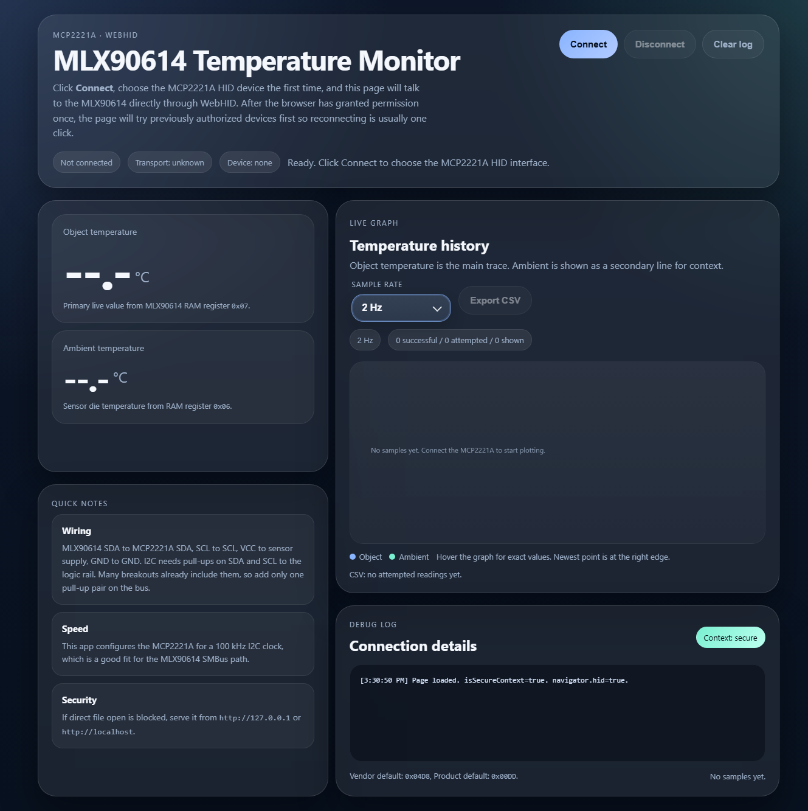

# MLX90614 Temperature Monitor

**[Open the temperature monitor](https://robomaniac.github.io/mlx90614-mcp2221a/)** — connect an MLX90614 through an MCP2221A and read temperatures directly in desktop Chrome or Edge.

I wanted a simple way to see infrared temperature readings and a live graph without managing a Python HID installation. This app uses Chrome's WebHID API to talk to the sensor through a USB-to-I2C bridge. Everything runs in one HTML file.

**Browser:** desktop Chrome / Edge · **Hardware:** MLX90614 + MCP2221A · **Updated:** 2026-10-10

  

*Browser interface before connecting the sensor.*

## Features

- Object and ambient temperature in **°C**, with a live chart and precise mouse hover.
- **1, 2, 4, 5 and 10 Hz** sample-rate controls.
- Remembered device permission for easier reconnecting.
- Successful and attempted sample counts, with failed reads retained in the debug log.
- One HTML file with embedded CSS and JavaScript; processing stays in your browser.

## Use it

1. Wire the sensor using the table below, then close other apps or tabs using the bridge. Open **[the app](https://robomaniac.github.io/mlx90614-mcp2221a/)** in desktop **Chrome or Edge**. You should see the interface above; stop if WebHID is unavailable.
2. Select **2 Hz** and click **Connect**. Choose the MCP2221A in the device chooser if prompted; previously granted permission may be reused automatically.
3. Expect changing object/ambient readings and growing chart points. Hover over the chart to inspect individual samples. The debug log should show an initial sample and periodic `Read OK` entries.
4. Try other sample rates as needed. **10 Hz is a requested rate**; actual successful throughput depends on the hardware and read retries. Keep failed-read logs when troubleshooting.
5. Click **Disconnect** before closing the tab. Reloading starts a fresh chart and log.

For local editing, follow the [complete VS Code / PowerShell setup guide](08_Software/mlx90614-webhid/README.md#local-setup-and-operation). It includes exact check/server commands, expected results, restart instructions and cleanup. An existing local server can be reused after saving and reloading the HTML; there is no build or firmware-flash step.

For a native timing experiment, try the separate [Cython + HIDAPI demo](08_Software/mlx90614-hidapi-demo/README.md). It records every attempted pair to CSV and measures successful rate, latency and missed polling slots. Hardware trials completed **60 Hz over one minute with zero missed scheduled slots**; experimental [unpaced acquisition](08_Software/mlx90614-hidapi-demo/README.md#remove-the-scheduled-wait) reached **83.20 validated pairs/s over one minute**. An earlier unpaced failure is retained in the [results and limits](05_Data/NATIVE_HARDWARE_TESTS.md#unpaced-acquisition-no-target-period). Its Windows launcher handles setup/build; run it with the browser disconnected.

For contact temperature, open the separate **[Qwiic thermocouple monitor](https://robomaniac.github.io/mlx90614-mcp2221a/thermocouple.html)** for the **SparkFun MCP9600**. It adds probe/board temperatures, a hoverable graph and CSV export. The [native dashboard guide and detailed BOM](08_Software/qwiic-thermocouple/README.md) explain the shared Cython/HIDAPI environment and direct WebHID option.

## Hardware

### Detailed bill of materials

| Qty | Component | Manufacturer / part | Relevant specifications |
| --- | --- | --- | --- |
| 1 | Infrared temperature sensor | **Melexis MLX90614BAA**; supplied marking `BAA7160B20` | TO-39 package; single zone; **90° FOV**; **2.6–3.6 V VDD**; SMBus address **`0x5A`**; **0.02 °C digital resolution** |
| 1 | USB-to-I2C bridge board | **Microchip MCP2221A**; reference breakout: [**Adafruit #4471**](https://www.adafruit.com/product/4471) | I2C commands over HID; project bus **100 kHz**. Reference board includes a **3.3 V regulator** and **5.1 kΩ SDA/SCL pull-ups**, with logic set to 3.3 V by default. |

`BAA` identifies the sensor variant; `7160B20` is the lot marking. The exact sensor breakout model and full ordering code are not established. Adafruit #4471 is the reference bridge board from the project history; the physical board model has not been confirmed. Sensor specifications and marking are documented in the [Melexis datasheet](https://www.melexis.com/-/media/files/documents/datasheets/mlx90614-datasheet-melexis.pdf).

### Wiring

For the Adafruit #4471 reference board with **3.3 V logic**:

| Bridge board pin | Sensor signal | Bare MLX90614 TO-39 pin |
| --- | --- | --- |
| **3V** (regulated 3.3 V) | VDD | **3** |
| **GND** | VSS / ground | **4** |
| **SDA** | SDA / PWM | **2** |
| **SCL** | SCL / Vz | **1** |

The reference board's pull-ups are already fitted. Keep its logic jumper at **3.3 V**; the BAA sensor uses the 3 V supply variant. TO-39 pin numbers refer to the manufacturer's package drawing, not a breakout's header order. For a sensor module, confirm its supply input and header labels before using this mapping. See the [bridge pinout](https://learn.adafruit.com/circuitpython-libraries-on-any-computer-with-mcp2221/pinout) and [sensor pin description, page 6](https://www.melexis.com/-/media/files/documents/datasheets/mlx90614-datasheet-melexis.pdf#page=6).

## Troubleshooting

If device access is unavailable, use desktop Chrome/Edge over HTTPS or the documented loopback server. Browser permission is tied to the page's origin, so moving between the live site and localhost can show the chooser again.

For busy responses, PEC errors or HID timeouts, keep the debug log, close competing bridge clients and start at 2 Hz. Follow the [connection recovery procedure](08_Software/mlx90614-webhid/README.md#reuse-editing-and-restart) if readings do not resume. Automatic USB reset is disabled.

Software checks and the live Pages deployment pass. The edited browser transport still needs hardware validation; the separate native demo has measured short-run results. See the [test results and remaining checks](05_Data/VALIDATION.md).

## Project files

| Folder | Contents |
| --- | --- |
| `08_Software/mlx90614-webhid/` | Active **`mlx.html`**, operating guide and check tools |
| `08_Software/mlx90614-hidapi-demo/` | Separate native transport, terminal timing demo, CSV logging and Windows launcher |
| `08_Software/qwiic-thermocouple/` | MCP9600 contact-temperature dashboard, native reader, single-file WebHID app and BOM |
| `00_Documentations/` | Hardware/protocol notes, troubleshooting and development guides |
| `04_Media/` | Interface screenshots |
| `05_Data/` | Diagnostic logs, validation results and SHA-256 manifest |
| `99_Archive/webhid-history/` | Original HTML revisions for comparison |

## Guides

- [Setup, operation and recovery](08_Software/mlx90614-webhid/README.md).
- [Cython + HIDAPI timing experiment](08_Software/mlx90614-hidapi-demo/README.md).
- [Native hardware timing results](05_Data/NATIVE_HARDWARE_TESTS.md).
- [Qwiic thermocouple setup, BOM and timing limits](08_Software/qwiic-thermocouple/README.md).
- [Hardware and protocol](00_Documentations/HARDWARE_AND_PROTOCOL.md).
- [Known issues and hardware test plan](00_Documentations/KNOWN_ISSUES_AND_TEST_PLAN.md).
- [Local checks, GitHub and Pages updates](00_Documentations/GITHUB_PAGES.md).
- [Development history and revision comparisons](00_Documentations/VERSION_INDEX.md).

## License

[MIT](LICENSE).

## Author

Jérôme Demers — [robomaniac](https://github.com/robomaniac).
